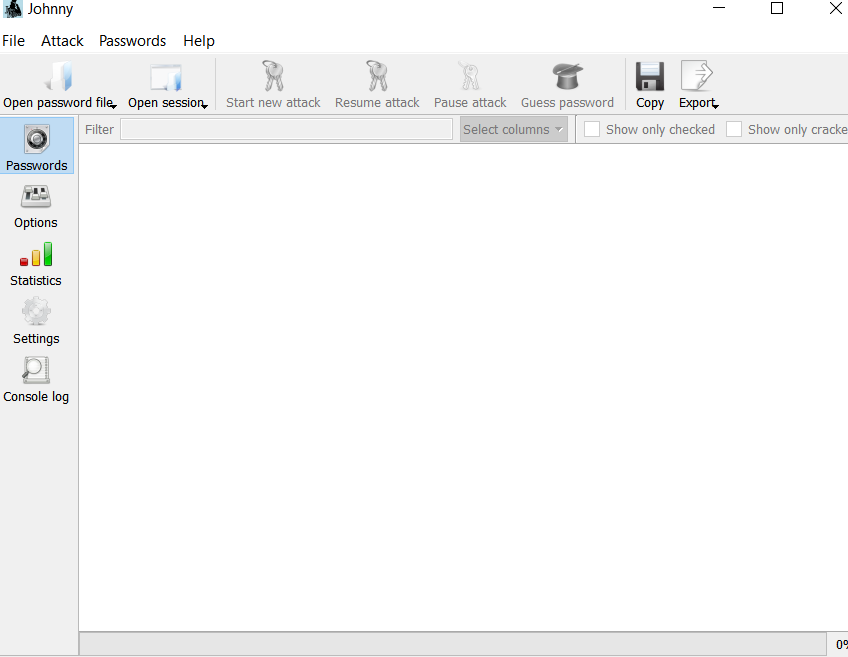
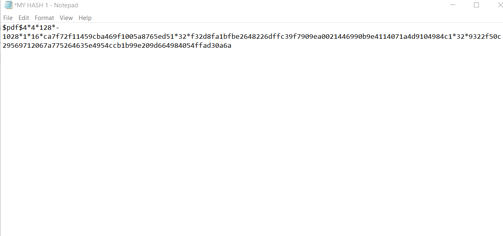
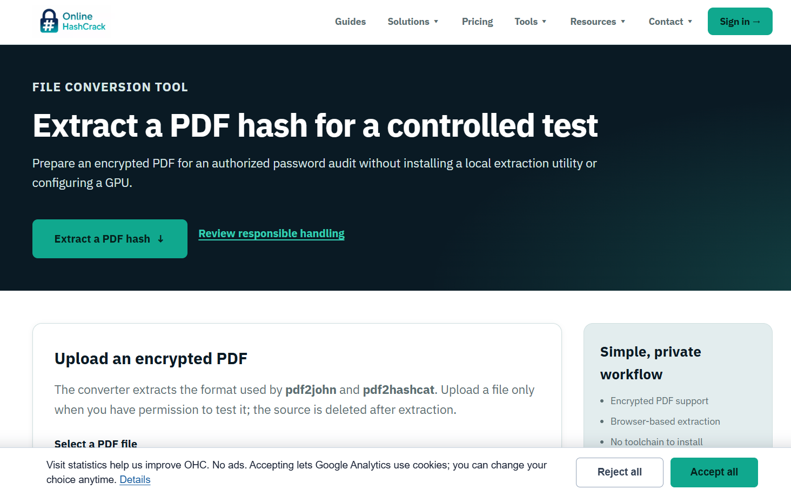
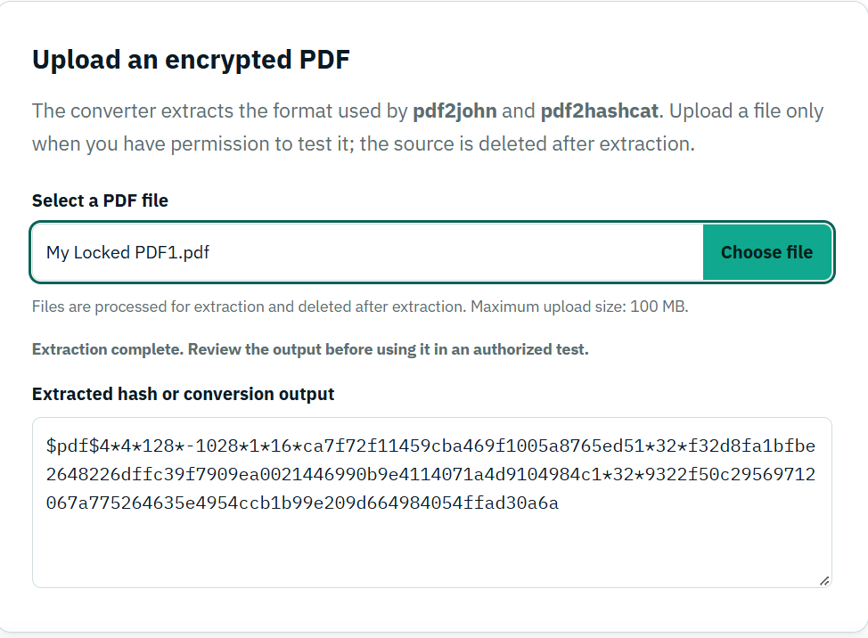
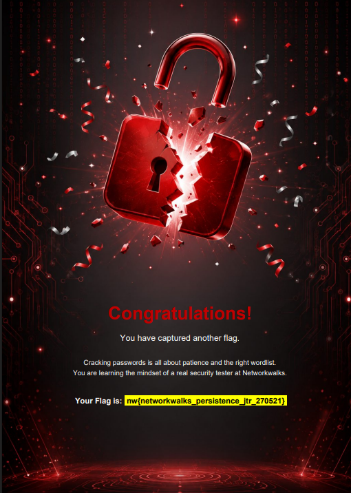
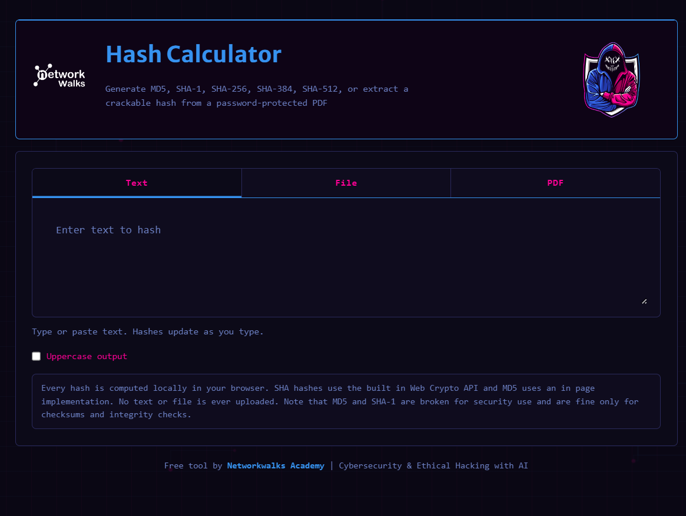
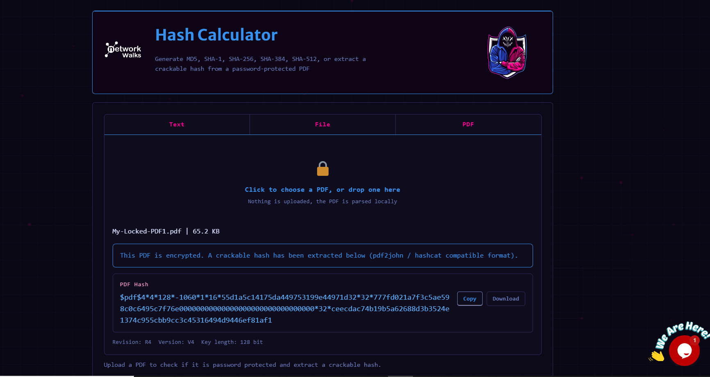
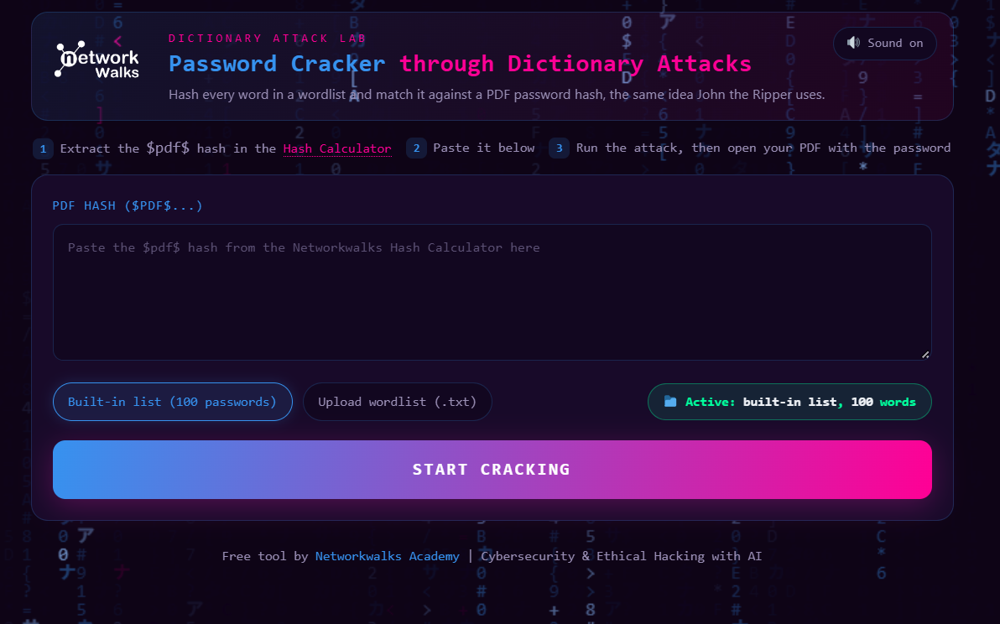
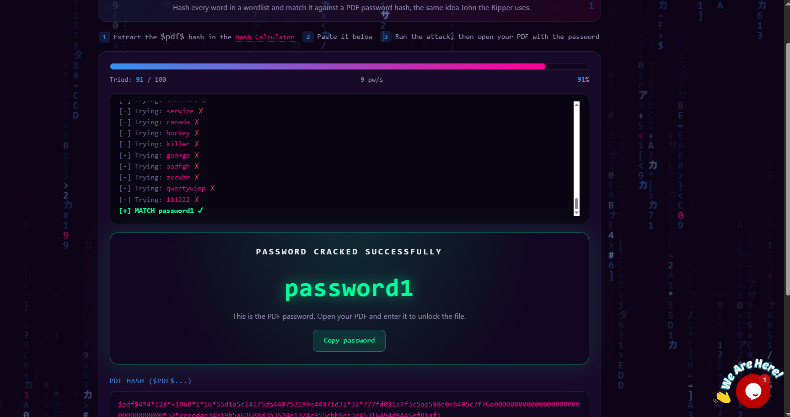

<h1 align="center">🔐 NetworkWalks Cybersecurity Internship – Week 3</h1>

<h3 align="center">Password Recovery & Security Auditing</h3>

  <strong>Practical Cybersecurity Training with John the Ripper, Johnny GUI & NetworkWalks Tools</strong>

  <strong>Batch B084 | Week 3 Practical Modules</strong>

  
  

---

## 📌 Project Overview

This repository documents my **Week 3 practical activities** as part of the NetworkWalks Cybersecurity Internship – Batch B084.

During this week, I worked on practical exercises related to PDF password recovery, hash extraction, and password security auditing.

The assigned exercises involved using **John the Ripper (JTR), Johnny GUI, and NetworkWalks online tools** in an authorized educational training environment.

This repository contains the practical workflows, screenshots, and learning outcomes from both project modules.

---

## 🎯 PM1 – Password Recovery with John the Ripper (JTR) & Johnny

### Objective

To understand PDF password recovery and learn how John the Ripper and Johnny GUI are used in password auditing exercises.

### Tools Used

- **John the Ripper (JTR):** Password auditing and recovery tool.
- **Johnny GUI:** Graphical interface for John the Ripper.
- **Notepad:** Used to view and inspect the extracted PDF hash.
- **Online Hash Cracker:** Used for the assigned training exercise.

### Practical Workflow

1. Prepared the John the Ripper and Johnny applications.
2. Located the John executable in the program folder.
3. Opened Johnny and configured its executable location.
4. Selected the assigned sample PDF file.
5. Extracted the PDF hash and saved it as `hash1.txt`.
6. Opened the extracted hash file using Notepad.
7. Used the assigned online hash-cracking tool.
8. Observed the recovery process and documented the practical results.

### 📸 PM1 – Screenshots & Evidence

**01. Johnny Application Opened**

  

**02. PDF Hash in Notepad**

  

**03. Online Hash Cracker Opened**

  

**04. Online Hash Cracker Result**

  

**05. Password Recovery Result – 01**

  

**06. Password Recovery Result – 02**

  

**07. Password Recovery Result – 03**

  

---

## 🎯 PM2 – Password Recovery with NetworkWalks Tools

### Objective

To understand how NetworkWalks online tools generate PDF hashes and perform password recovery exercises.

### Tools Used

- **NetworkWalks Hash Calculator:** Used to generate a hash from the assigned PDF file.
- **NetworkWalks Password Cracker:** Used to perform the assigned password recovery exercise using the extracted hash.

### Practical Workflow

1. Opened the NetworkWalks Hash Calculator.
2. Uploaded the assigned sample training PDF.
3. Generated the PDF hash.
4. Viewed the generated hash result.
5. Opened the NetworkWalks Password Cracker.
6. Entered the extracted hash.
7. Started the password recovery process.
8. Observed and documented the results.

### 📸 PM2 – Screenshots & Evidence

**01. Hash Calculator Opened**

  

**02. Hash Calculator Result**

  

**03. Password Cracker Opened**

  

**04. Password Cracker Result**

  

---

## 🛠️ Skills & Learning Outcomes

Through these practical exercises, I gained experience in:

- Understanding PDF password recovery concepts.
- Introduction to John the Ripper.
- Working with the Johnny graphical interface.
- PDF hash extraction and preparation.
- Inspecting extracted hash files using Notepad.
- Using online password recovery tools.
- Understanding basic password auditing workflows.
- Documenting cybersecurity practical activities.

---

## 🔒 Training & Security Note

All practical activities were performed for educational purposes using the sample PDF files, hashes, and assigned resources provided for internship training.

The exercises were limited to the assigned internship tasks and authorized training resources.

---

## 👨‍💻 Internship Information

| Detail | Information |
|:---|:---|
| Organization | NetworkWalks |
| Internship | Cybersecurity Internship |
| Batch | B084 |
| Week | 03 |
| Practical Modules | PM1 & PM2 |
| Instructor | Waqas Karim (CCIE) |

---

## 👤 About Me

**Musadiq Mehmood Qureshi**

BSCS Graduate | Cybersecurity Learner

- **GitHub:** [github.com/musadiq-qureshi](https://github.com/musadiq-qureshi)
- **LinkedIn:** [linkedin.com/in/musadiq-qureshi-32271936a](https://www.linkedin.com/in/musadiq-qureshi-32271936a/)

---

  <b>Learning • Practicing • Growing in Cybersecurity 🚀</b>

